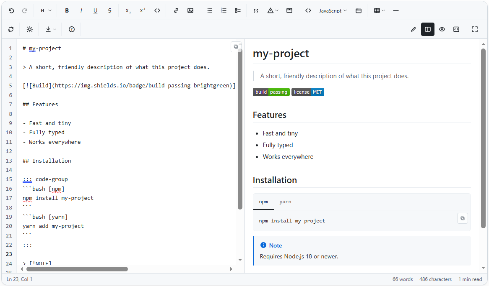

<div align="center">


# React Markdown Studio

**The zero-dependency Markdown editor for React.** Live split preview, GitHub-style alerts, tabbed code groups, tables, task lists and a security-hardened renderer. TypeScript-first, SSR-safe and ready for Next.js.

[](https://www.npmjs.com/package/react-markdown-studio)
[](https://www.npmjs.com/package/react-markdown-studio)
[](https://github.com/AKASHNEGI-github/react-markdown-studio/actions/workflows/ci.yml)
[](LICENSE)




### [Live demo and playground](https://akashnegi-github.github.io/react-markdown-studio/) &nbsp;·&nbsp; [API](docs/API.md) &nbsp;·&nbsp; [Syntax guide](docs/SYNTAX.md) &nbsp;·&nbsp; [Changelog](CHANGELOG.md)

</div>

---

React Markdown Studio is a **React Markdown editor** and **Markdown renderer** in one package. Drop in `<MarkdownEditor />` for a complete writing experience (toolbar, shortcuts, undo/redo, split-view live preview, export) or `<MarkdownViewer />` / `markdownToHtml()` to display Markdown safely, on the client or on the server.

It has **no runtime dependencies**, ships ESM and CommonJS with full TypeScript types, and renders on the server without a DOM, so it works in Next.js, Remix, Vite, Create React App and plain Node.

```tsx
import { useState } from "react";
import { MarkdownEditor } from "react-markdown-studio";
import "react-markdown-studio/styles.css";

export default function Notes() {
  const [markdown, setMarkdown] = useState("# Hello, **world**");
  return <MarkdownEditor value={markdown} onChange={setMarkdown} height="480px" />;
}
```

## Features

| | |
|---|---|
| **Live split preview** | Edit, split, preview and HTML-source modes, synchronised scrolling, responsive layout |
| **Rich toolbar and shortcuts** | Bold, italic, headings, lists, links, images, tables, quotes and more; every button is a tested pure function |
| **GitHub-style alerts** | `> [!NOTE]`, `TIP`, `IMPORTANT`, `WARNING`, `CAUTION` |
| **Collapsible sections** | `<details>` blocks containing any Markdown |
| **Tabbed code groups** | One block of Markdown becomes npm / pnpm / yarn tabs, with titles and copy buttons |
| **Smart tables** | Alignment plus a context toolbar to add and remove rows and columns |
| **Interactive task lists** | Tick a checkbox in the preview and the Markdown source updates |
| **Syntax highlighting** | 18 languages built in (no Prism or highlight.js), or bring your own highlighter |
| **Export** | Print to PDF, download `.md`, or download a standalone `.html` page |
| **Paste and drop images** | Provide `onImageUpload`; without it nothing is ever embedded or sent anywhere |
| **Smart editing** | Paste a URL over selected text to link it, `Tab` nests lists correctly, `Enter` continues lists and quotes |
| **Themeable** | Light, dark and auto, with every colour a CSS variable (`--rmds-*`) |
| **Accessible** | ARIA toolbar that is one tab stop with arrow-key navigation, labelled controls |
| **Secure by design** | Scheme-allow-listed URLs, no raw HTML execution, linear-time depth-limited parsing, strict-CSP mode |
| **SSR-safe** | The parser and HTML renderer need no DOM; components render on the server and hydrate cleanly |

## Install

```bash
npm install react-markdown-studio
# or: pnpm add react-markdown-studio   |   yarn add react-markdown-studio   |   bun add react-markdown-studio
```

Requires React 18 or 19. Import the stylesheet once:

```tsx
import "react-markdown-studio/styles.css";
```

## Usage

### Editor

```tsx
import { MarkdownEditor } from "react-markdown-studio";

<MarkdownEditor
  value={markdown}
  onChange={setMarkdown}
  theme="auto"                  // "light" | "dark" | "auto"
  height="600px"
  onImageUpload={async (file) => (await upload(file)).url}   // optional
/>
```

Uncontrolled use (`defaultValue`) and a ref with `getMarkdown()`, `setMarkdown()`, `insertText()`, `downloadMarkdown()`, `downloadHtml()` and more are covered in the [API reference](docs/API.md).

### Viewer (read-only)

```tsx
import { MarkdownViewer } from "react-markdown-studio";

<MarkdownViewer value={post.body} headingOffset={1} />
```

`headingOffset` shifts `#` to `<h2>` so embedded content fits your page outline without changing how it looks.

### Server-side rendering and Next.js

The editor and viewer are client components (they carry the `"use client"` directive) and render safely on the server before hydrating. The parser and HTML renderer are plain functions that run anywhere, including React Server Components, route handlers and edge functions:

```ts
import { markdownToHtml, markdownToHtmlDocument } from "react-markdown-studio/core";

const html = markdownToHtml(userInput);                 // an HTML fragment
const page = markdownToHtmlDocument(userInput, { title: "My doc" }); // a complete standalone page
```

### Strict Content-Security-Policy

By default the HTML renderer emits two tiny inline scripts (code-group tabs and copy buttons). Under a strict CSP, turn them off and add the behaviour from your own bundle:

```ts
import { markdownToHtml, enhanceHtml } from "react-markdown-studio";

container.innerHTML = markdownToHtml(src, undefined, { scripts: false });
const stop = enhanceHtml(container);   // call stop() to remove the listener
```

## Markdown cheat sheet

| You type | You get | Shortcut |
|---|---|---|
| `**bold**` | **bold** | Ctrl+B |
| `*italic*` | *italic* | Ctrl+I |
| `~~strike~~` | ~~strike~~ | Ctrl+Shift+X |
| `` `code` `` | `code` | Ctrl+E |
| `[text](https://example.com)` | a link | Ctrl+K |
| `# Heading` … `###### Heading` | headings | Ctrl+1 / 2 / 3 |
| `- item` / `1. item` | bulleted / numbered list | Ctrl+Shift+8 / 7 |
| `- [ ] task` | task list | Ctrl+Shift+9 |
| `> quote` | blockquote | Ctrl+Shift+. |
| `> [!WARNING]` + `> text` | alert callout | |
| ` ```ts [file.ts] ` | highlighted code block with a title | |
| `::: code-group` … `:::` | tabbed code group | |
| `<details><summary>…</summary>…</details>` | collapsible section | |

The complete, rendered guide, generated from the same data as the in-editor help, is in [docs/SYNTAX.md](docs/SYNTAX.md) and on the [website](https://akashnegi-github.github.io/react-markdown-studio/#syntax).

## Theming

Light, dark and auto are built in. Override any variable on the editor's root:

```css
.my-editor {
  --rmds-accent: #e11d48;
  --rmds-bg: #fff7f9;
  --rmds-border: #f4c2cd;
}
```

## Security

React Markdown Studio is built to render **untrusted** Markdown:

- Link and image URLs are limited to `http:`, `https:`, `mailto:` and relative URLs, validated with the same URL parser browsers use, so control-character and mixed-case tricks cannot smuggle in `javascript:`.
- Raw HTML is never executed. Only `<u>`, `<sub>`, `<sup>`, `<details>` and `<summary>` are recognised.
- Parsing is linear-time and depth-limited: unclosed brackets, pathological emphasis and thousands of nested quotes or lists cannot hang or crash a browser tab or a server.
- `scripts: false` keeps output compatible with strict Content-Security-Policy; `headingIdPrefix` defends against DOM clobbering.

These behaviours are covered by regression tests, including fuzz-style checks of every leading control character. No software can promise absolute security. See [SECURITY.md](SECURITY.md) to report a vulnerability privately.

## How it compares

Measured facts from the public npm registry (4 November 2026). Sizes are unpacked tarballs, excluding dependencies.

| Package | Style | Runtime deps | Unpacked | Last updated |
|---|---|---:|---:|---|
| **react-markdown-studio** | Source + preview | **0** | 616 KB ¹ | Nov 2026 |
| @uiw/react-md-editor | Source + preview | 4 | 4.3 MB | Nov 2026 |
| @mdxeditor/editor | WYSIWYG | 57 | 644 KB | Nov 2026 |
| @milkdown/crepe | WYSIWYG | 17 | 3.4 MB | Oct 2026 |
| react-markdown-editor-lite | Source + preview | 3 | 483 KB | Jan 2026 |
| react-mde | Source + preview | 0 | 602 KB | Jun 2022 |
| react-simplemde-editor | Source + preview | 1 | 565 KB | Oct 2022 |

¹ Includes ESM, CommonJS and type definitions; the npm download is about 109 kB.

Different tools suit different jobs. WYSIWYG editors (MDXEditor, Milkdown) give a rich-text experience; this is a source-plus-preview editor like GitHub's, where you always see and control the Markdown. If you only need to *display* Markdown and want a large plugin ecosystem, a renderer-only library such as `react-markdown` may be the better fit.

## FAQ

**Does it work with Next.js App Router?** Yes. Import the components from a Client Component, or use `react-markdown-studio/core` anywhere on the server.

**Is it a WYSIWYG editor?** No, it is a source-plus-preview editor. You write real Markdown and always control what is saved.

**Can I use it commercially?** Yes, it is MIT licensed.

More answers are on the [website](https://akashnegi-github.github.io/react-markdown-studio/#faq).

## Migrating from `akash-negi-markdown-editor`

The previous package name is deprecated. See the [migration guide](docs/MIGRATION.md): it is a rename plus a CSS prefix change (`mde-` to `rmds-`).

## Contributing

Contributions are welcome. See [CONTRIBUTING.md](CONTRIBUTING.md) for setup, scripts and the pull-request checklist, and [CODE_OF_CONDUCT.md](CODE_OF_CONDUCT.md).

```bash
git clone https://github.com/AKASHNEGI-github/react-markdown-studio.git
cd react-markdown-studio && npm install
npm test            # unit, component and SSR tests
npm run dev         # website + playground at http://localhost:5173
```

## License

[MIT](LICENSE) © [Akash Negi](https://github.com/AKASHNEGI-github)
